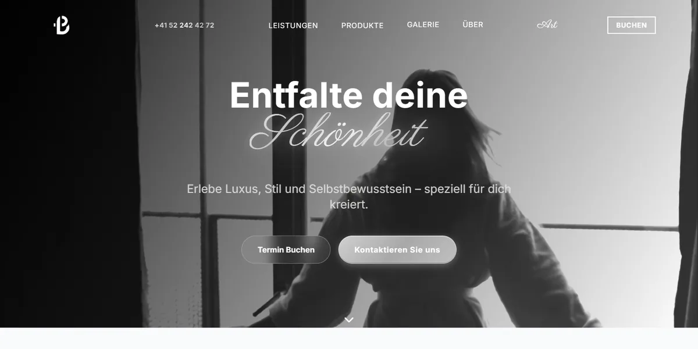
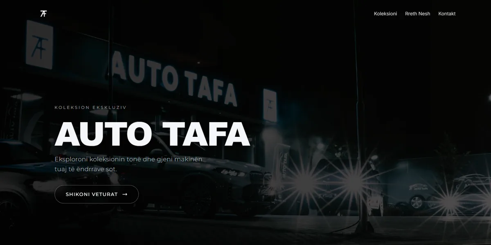
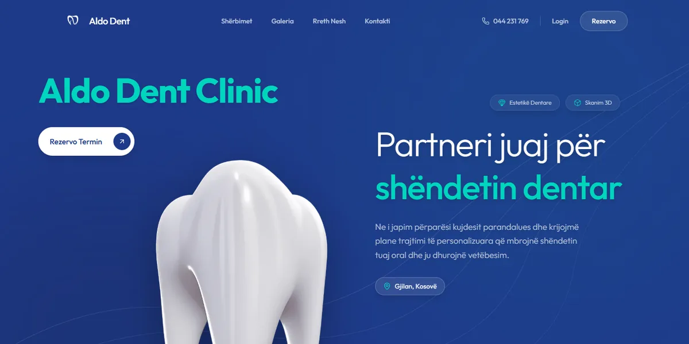
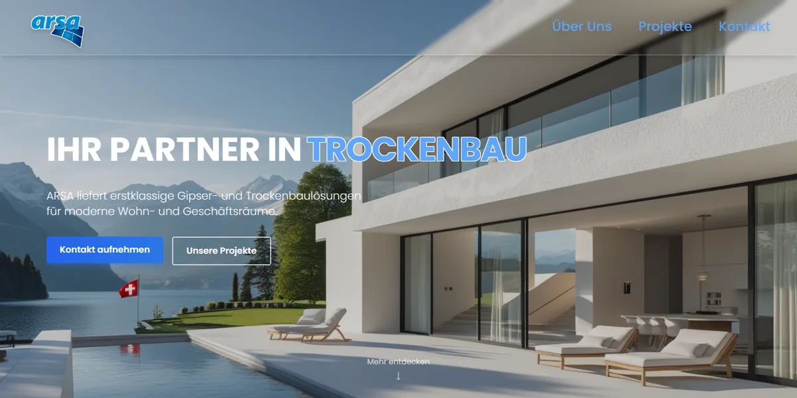
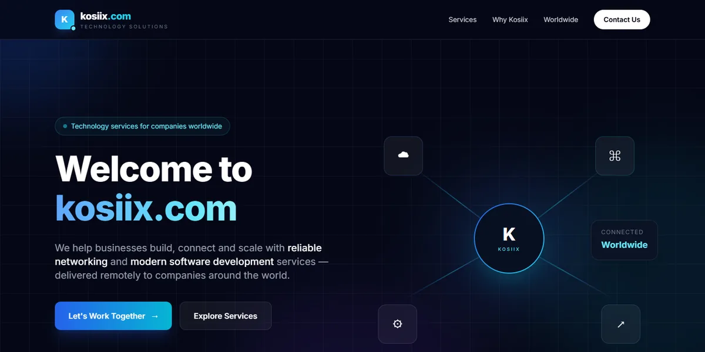
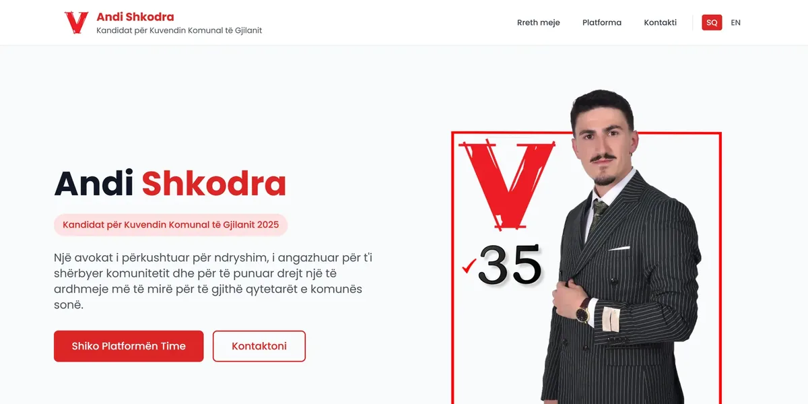

  

  <a href="https://arthalimi.com"><b>arthalimi.com</b></a>
  &nbsp;&nbsp;·&nbsp;&nbsp;
  <a href="https://www.linkedin.com/in/arthalimi">LinkedIn</a>
  &nbsp;&nbsp;·&nbsp;&nbsp;
  <a href="https://github.com/ArtHalimi7/arthalimi.com">Studio site source</a>

  

I run **[Art Halimi Studio](https://arthalimi.com)**, an independent software studio in Germany. I design and build the whole product, from interface to backend, database and deployment, and keep it running after launch.

 

## Client websites

<table>
  <tr>
    <td width="50%" valign="top">
      
      
<b>LB Hairdesign</b>&nbsp;&nbsp;Hair salon · Winterthur, CH

      
Salon website with online booking, customer accounts and an admin back office for bookings and services.

      
<code>React</code> <code>Express</code> <code>MySQL</code>

      
<a href="https://lbhairdesign.ch">Live site ↗</a>

    </td>
    <td width="50%" valign="top">
      
      
<b>Auto TAFA</b>&nbsp;&nbsp;Car dealership · Gjilan, XK

      
Luxury car dealership with a browsable collection, car detail pages, financing and custom-sourcing requests, and an admin dashboard.

      
<code>React</code> <code>Express</code> <code>MySQL</code> <code>Cloudinary</code>

      
<a href="https://tafaleka.com">Live site ↗</a>&nbsp;&nbsp;·&nbsp;&nbsp;<a href="https://github.com/ArtHalimi7/TAFA">Code</a>

    </td>
  </tr>
  <tr>
    <td width="50%" valign="top">
      
      
<b>AldoDent</b>&nbsp;&nbsp;Dental clinic · Gjilan, XK

      
Clinic website with online appointment booking and a staff dashboard for doctors and schedules.

      
<code>React</code> <code>Express</code> <code>PostgreSQL</code>

      
<a href="https://aldodent.netlify.app">Live site ↗</a>&nbsp;&nbsp;·&nbsp;&nbsp;<a href="https://github.com/ArtHalimi7/aldodent-clinic">Code</a>

    </td>
    <td width="50%" valign="top">
      
      
<b>ARSA Gipser</b>&nbsp;&nbsp;Plastering &amp; drywall · Volketswil, CH

      
Marketing site for a Swiss plastering firm, with a project gallery and a contact flow that emails enquiries.

      
<code>React</code> <code>Tailwind CSS</code> <code>Framer Motion</code>

      
<a href="https://arsagipser.ch">Live site ↗</a>&nbsp;&nbsp;·&nbsp;&nbsp;<a href="https://github.com/ArtHalimi7/arsaV2">Code</a>

    </td>
  </tr>
  <tr>
    <td width="50%" valign="top">
      
      
<b>KOSIIX</b>&nbsp;&nbsp;Networking &amp; software services

      
Corporate site for a technology partner that delivers networking and software development to companies worldwide.

      
<code>React</code> <code>three.js</code> <code>GSAP</code>

      
<a href="https://kosiix.com">Live site ↗</a>&nbsp;&nbsp;·&nbsp;&nbsp;<a href="https://github.com/ArtHalimi7/Kosiix">Code</a>

    </td>
    <td width="50%" valign="top">
      
      
<b>Andi Shkodra</b>&nbsp;&nbsp;Election campaign · Gjilan, XK

      
Bilingual (Albanian and English) campaign site for a Municipal Assembly candidate, with platform pages and a contact form.

      
<code>React</code> <code>Tailwind CSS</code> <code>i18n</code>

      
<a href="https://github.com/ArtHalimi7/Andi-Shkodra">Code</a>

    </td>
  </tr>
</table>

 

## Products and experiments

<table>
  <tr>
    <td width="26%"><a href="https://github.com/ArtHalimi7/ZahlxV2"><b>ZahlX</b></a></td>
    <td>Point of sale, inventory and double-entry bookkeeping for small businesses, with a Gemini AI assistant.</td>
    <td width="24%"><code>React</code> <code>Express</code> <code>MySQL</code></td>
  </tr>
  <tr>
    <td><a href="https://github.com/ArtHalimi7/prospectly"><b>Prospectly</b></a></td>
    <td>B2B lead generation: finds well-reviewed local businesses with no website, scores intent and drafts outreach.</td>
    <td><code>React</code> <code>Express</code> <code>Gemini</code></td>
  </tr>
  <tr>
    <td><a href="https://github.com/ArtHalimi7/arthalimi.com"><b>arthalimi.com</b></a></td>
    <td>My studio's own site: prerendered EN/DE pages, a scroll-driven 3D hero and a WebGL scene.</td>
    <td><code>React</code> <code>WebGL</code> <code>Vite</code></td>
  </tr>
  <tr>
    <td><a href="https://github.com/ArtHalimi7/launchy-web"><b>Launchy</b></a></td>
    <td>Landing page for creators, told by a real-time 3D iPhone.</td>
    <td><code>Next.js</code> <code>three.js</code></td>
  </tr>
  <tr>
    <td><a href="https://github.com/ArtHalimi7/aire-showcase"><b>AIRE</b></a></td>
    <td>Scroll-told launch concept for an invented fragrance: a day passes as you scroll.</td>
    <td><code>three.js</code> <code>GSAP</code></td>
  </tr>
</table>

 

  Have something that has outgrown spreadsheets and off-the-shelf tools? <a href="https://arthalimi.com"><b>Let's talk ↗</b></a>

